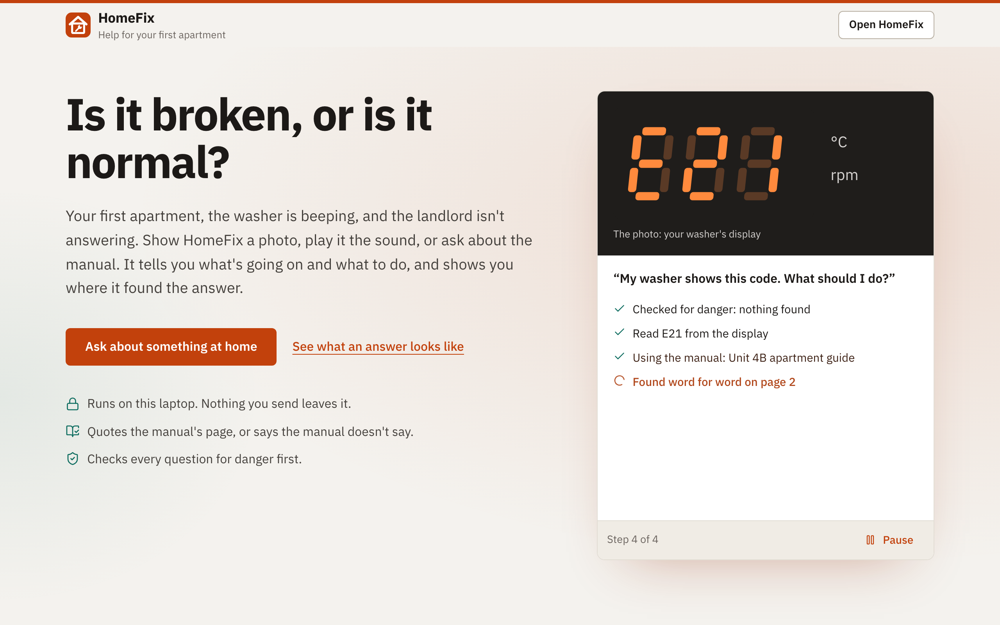
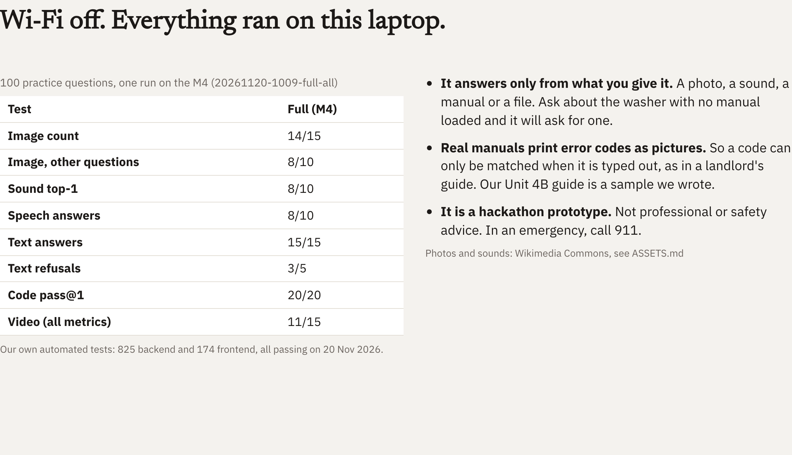
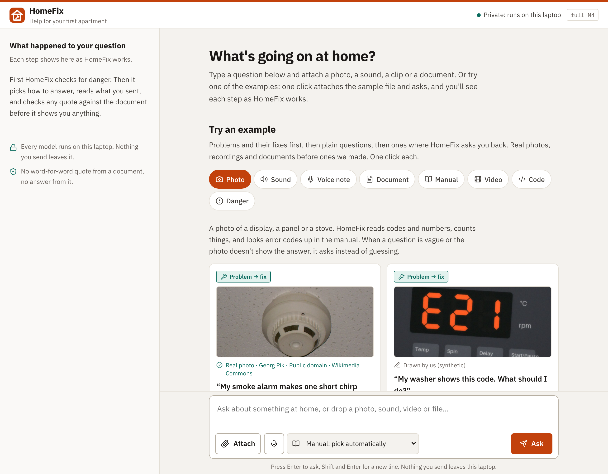
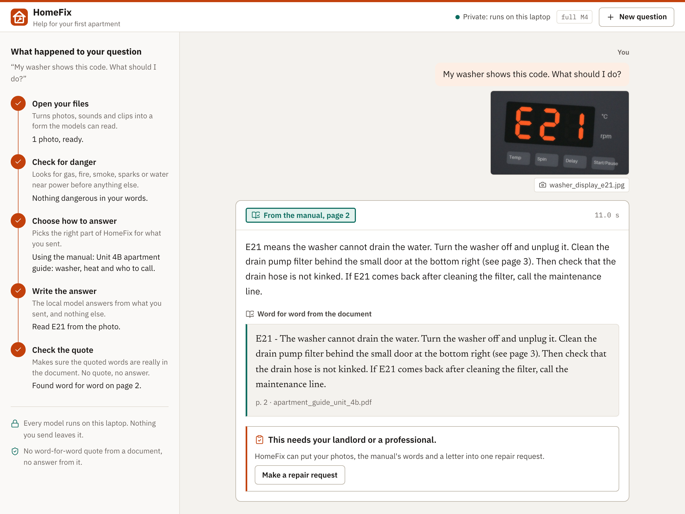
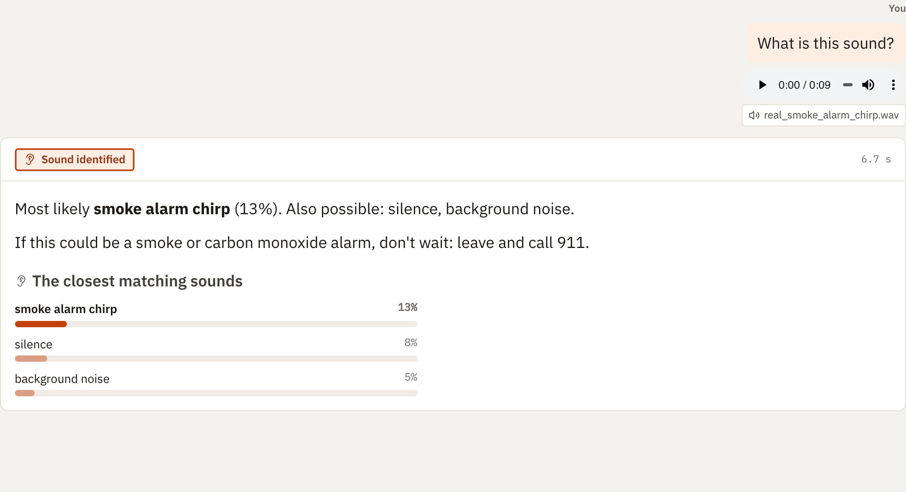
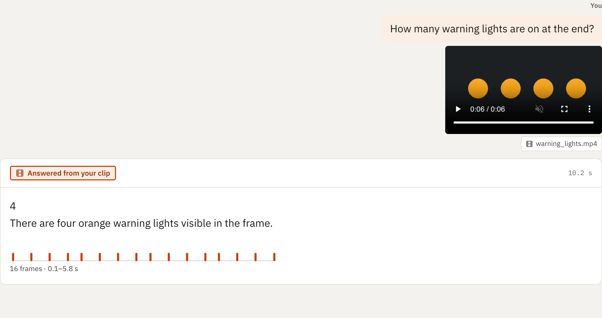
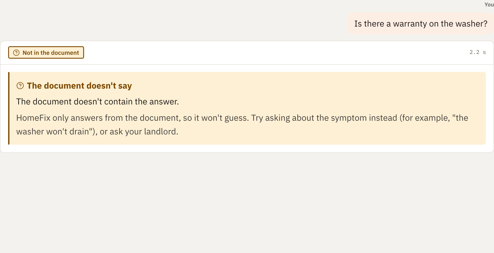
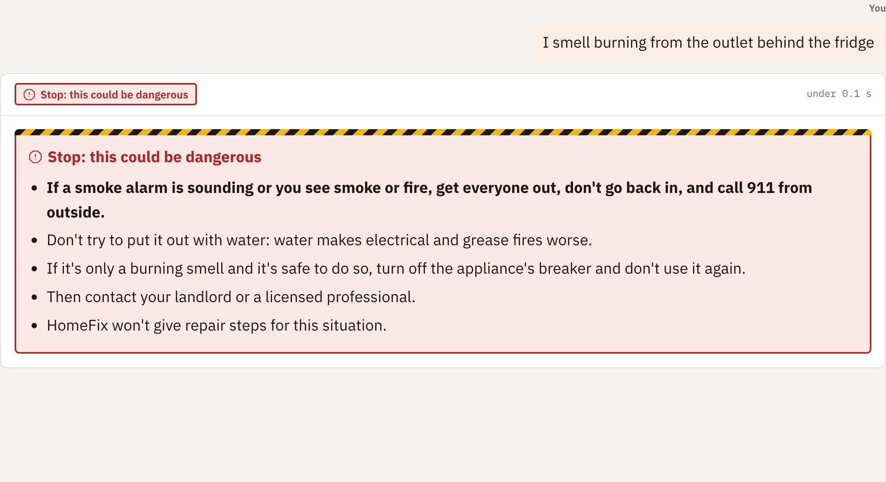
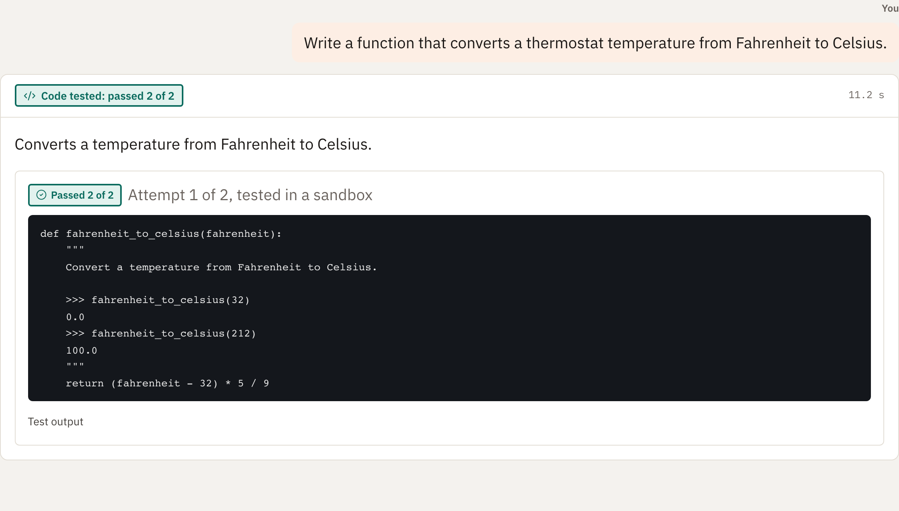

<div align="center">

# HomeFix

**Is it broken, or is it normal?**

A local assistant for students renting their first apartment. Show it a photo, play it a beep, ask about
the landlord's guide or send a short video. It answers on your own laptop, with Wi-Fi off, and shows
where the answer came from.

      

[Demo](#demo) · [See it work](#see-it-work) · [Quick start](#quick-start) · [Docs](#documentation)

</div>



Built for the **IEEE AI Hackathon 2026, Multimodal LLM Challenge ("Build AI we own")** by Meghana R and
Akshayaa Mahesh.

> **Hackathon prototype.** Not professional or safety advice. In an emergency, call 911.
> Every model runs on the laptop. Nothing you send leaves it.

## Contents

- [Demo](#demo)
- [What it does](#what-it-does)
- [See it work](#see-it-work)
- [How an answer is decided](#how-an-answer-is-decided)
- [Quick start](#quick-start)
- [Results](#results)
- [Documentation](#documentation)
- [Limitations](#limitations)
- [Team](#team)
- [Credits and licenses](#credits-and-licenses)

## Demo

The app has a built-in demo at `#/demo`: eight short scenes (the problem, photo to manual, sound, video,
honesty, danger, code, proof), each a real answer recorded on the M4. It never calls a model, so it works
with Wi-Fi off. On the front page, click **Ask about something at home** to play it. Each scene builds up
by itself and ends on the answer; `→` goes to the next one.



How to run it in front of a room, re-record it and check the laptop first: [docs/DEMO.md](docs/DEMO.md).

## What it does

When something in your first apartment beeps, blinks or leaks, you have to work out what it means, find
the manual and decide whether it is dangerous. The landlord may not answer. HomeFix does that work.

1. **Check for danger.** Every question is checked for gas, fire, smoke, sparks, exposed wires and water
   near power before any model runs. If it matches, you get the fixed safety steps and no repair advice.
2. **Pick how to answer.** Plain code picks the right part of HomeFix from what you sent: a photo, a sound,
   a voice note, a document, a video or a coding task.
3. **Answer on the laptop.** Open-weight models read the photo, label the sound, transcribe the voice note
   or watch the clip's frames.
4. **Check before showing.** A document answer is shown only with a quote that is really in the document,
   and its page. A display read two ways is read a third time. Generated code is tested in a sandbox.
5. **Hand it on.** If it's a job for the landlord, **Make a repair request** puts the photos, the manual's
   words and a letter into one dated, fingerprinted page to print or save as PDF.

**Example**, a photo of a washer display showing E21, with our sample Unit 4B apartment guide:

> **My washer shows this code. What should I do?**
>
> E21 means the washer cannot drain the water. Turn the washer off and unplug it. Clean the drain pump
> filter behind the small door at the bottom right (see page 3). Then check that the drain hose is not
> kinked. If E21 comes back after cleaning the filter, call the maintenance line.
>
> *Word for word from the document, p. 2 · apartment_guide_unit_4b.pdf*

| You bring | HomeFix gives you |
| --- | --- |
| A photo | What it shows, a count, or the text on a display (error codes, labels, thermostat readings) |
| A photo of an error code | What the manual says the code means, with the page and the exact words |
| A sound | The top three sound labels with scores, and a warning if it could be an alarm |
| A voice note | The transcript, and an answer to your question about it |
| A document (lease, guide, manual; PDF, text or Word) | An answer with a word-for-word quote and page, or "the document doesn't contain the answer" |
| A short video | A count, which way something moves, or what happens, with the frames it looked at |
| A coding task | A Python function tested in a sandbox, with "passed 2 of 2" or what failed |
| Anything that sounds dangerous | A fixed safety message (gas: leave, don't touch a switch) and no repair steps |

**Who it is for.** A student in their first apartment, with a beeping appliance and a landlord who isn't
answering. Their workflow: show HomeFix the problem, read what it means and where that came from, and if
it's beyond them, send the repair request.

## See it work

**1. Pick an example, or ask your own.** One click attaches a sample file and asks. Real photos, recordings
and documents are marked with their source.



**2. Photo to manual.** HomeFix reads E21 from the display, picks the Unit 4B guide by itself, and quotes the
E21 row on page 2. The left side lists every step it took. This is a live answer from the M4 (11.0 s).



**3. Sound.** The closest matching sounds with their scores, and what to do if it could be an alarm.



**4. Video.** A count from the frame where the most lights are on, with the 16 frames it looked at.



**5. Honesty.** When the document doesn't say, HomeFix says so instead of guessing.



**6. Danger.** A burning smell gets the fixed safety steps in under 0.1 s, before any model runs.



**7. Code.** The function and its examples, tested in a sandbox.



## How an answer is decided

Fixed rules have the final say. A model can make HomeFix more careful (stop, ask, refuse), never less.

- **Danger first:** danger words in a question or voice note get the fixed message for that danger before
  any model runs. A second check by meaning catches paraphrases; it can only add a stop.
- **Routing is plain code:** `app/router.py` picks the pipeline from the files and words, in about 0 ms.
- **No verified quote, no answer:** a document answer is shown only if its quote is in the document (word
  for word, or a fuzzy match of at least 92 for quotes of 8 words or more). Every number and code in the
  answer must be in the quote, and a question about an error code needs that code in the quote.
- **Displays are read twice:** if the reads disagree, a third read decides by majority; with no majority,
  HomeFix shows the reads and asks.
- **It asks instead of guessing** when a display question is vague, a code can't be read, or two manuals fit.
- **Generated code never runs in the app:** its examples run in a locked-down subprocess (no network,
  temporary folder, 10 s limit), with one retry.

Every safety layer, and what each one is measured to catch: [docs/SAFETY.md](docs/SAFETY.md).

## Quick start

Needs **macOS on Apple Silicon** and **Homebrew**. From a new terminal:

```bash
git clone https://github.com/meghana2108/Homefix.git && cd Homefix
bash scripts/setup_mac.sh                     # ffmpeg, Ollama, uv, Python 3.11, Node 20, all packages
bash scripts/pull_models.sh full --final      # open the Ollama app first; use lite on an 8 GB Mac
uv run python scripts/make_samples.py         # example files and sample manuals (offline)
uv run uvicorn app.api.main:app --port 8000   # terminal 1: the backend
cd frontend && npm run dev                    # terminal 2: the web app
```

Set `PROFILE=full` (16 GB) or `PROFILE=lite` (8 GB) in `.env` before starting the backend. Open
<http://localhost:5173> and click **Open HomeFix**, or **Ask about something at home** for the demo. Then
turn Wi-Fi off and run `bash scripts/offline_check.sh full`; it must print `OFFLINE CHECK PASSED`.

Every step with what to expect: [Getting started](docs/GETTING_STARTED.md). Stuck? See
[Troubleshooting](docs/DEVELOPMENT.md#troubleshooting).

**Without the browser:**

```bash
uv run python -m app.cli "What should I do?" --file frontend/public/samples/washer_display_e21.jpg \
  --manual apartment_guide_unit_4b
```

It prints each step and the answer, through the same code the API uses.

## Results

Our own run on the organizers' 100-question practice pack, scored with the metrics in
[docs/EVAL.md](docs/EVAL.md). Full tables: [results/summary_full.md](results/summary_full.md) (run
`20261120-1009-full-all`) and [results/summary_lite.md](results/summary_lite.md) (run
`20261119-1404-lite-all`).

The pack is general test data from public datasets (photos, sounds, speech, passages, coding tasks and
short clips). None of it is about apartments. It measures the skills HomeFix is built on: seeing,
hearing, reading, coding and watching video, offline, on our laptops.

| Modality | Metric | `full` (M4, 16 GB) | `lite` (M2, 8 GB) |
| --- | --- | --- | --- |
| Image | count exact | 14/15 | 14/15 |
| Image | other questions (fuzzy) | 8/10 | 9/10 |
| Audio | speech answers (fuzzy) | 8/10 | 6/10 |
| Audio | sound top-1 / top-3 | 8/10 · 9/10 | 8/10 · 9/10 |
| Text | answer match | 15/15 | 14/15 |
| Text | "not in the document" when it isn't | 3/5 (never refused wrongly) | 2/5 (never refused wrongly) |
| Code | pass@1 | 20/20 | 17/20 |
| Video | count / direction / other questions | 2/4 · 2/2 · 7/9 | 1/4 · 2/2 · 2/9 |
| **Total** | hits | **87/100** | **75/100** |

Speed (median, request to final answer, first model load included) and peak memory:

| | Image | Audio | Text | Code | Video | Peak memory |
| --- | --- | --- | --- | --- | --- | --- |
| `full` | 9.2 s | 2.9 s | 3.6 s | 12.7 s | 38.8 s | 7.2 GB |
| `lite` | 14.9 s | 22.7 s | 5.1 s | 24.3 s | 22.5 s | 3.0 GB |

Missed our own targets: image on `full` (9.2 s vs 8 s), video on `full` (38.8 s vs 25 s), audio on
`lite` (22.7 s vs 4 s for sounds and 15 s for speech). These runs were made before the model warm-up
was added (commit `f337823`); see [Limitations](#limitations) for what that changed on the M4.

## Documentation

| Page | What is in it |
| --- | --- |
| [Getting started](docs/GETTING_STARTED.md) | Twelve numbered steps from a new Mac to the offline check, plus the terminal CLI and phone use |
| [Demo](docs/DEMO.md) | The pitch run sheet, the `#/demo` page, `demo_check.py`, re-recording, the M2 backup |
| [Safety](docs/SAFETY.md) | Every safety layer, in order, and what each one was measured to catch |
| [Development](docs/DEVELOPMENT.md) | Configuration, tests, troubleshooting, modules, API routes and events |
| [Architecture](docs/ARCHITECTURE.md), [Models](docs/MODELS.md), [Eval](docs/EVAL.md) | Request flow and memory budget, why these models, how the practice pack is scored |
| [Plan](docs/PLAN.md), [Risks](docs/RISKS.md), [Decisions](docs/DECISIONS.md), [Assets](docs/ASSETS.md) | The build plan, what could go wrong, choices we made, every asset with its source and license |

## Limitations

The main ones are also on the front page and the demo's last scene.

<details>
<summary>Show all limitations</summary>

- **It answers only from what you give it.** No manual, no answer from a manual. It asks for one instead
  of guessing.
- **It is not a repair person.** It says what a code means and what the manual says. Anything inside a
  machine is for maintenance.
- **Small models can misread or miscount.** Crowded scenes (more than about 8 objects) and blurry text
  are weak spots. Video counting was 2/4 on `full`.
- **It refuses carefully and misses some refusals.** It never refused an answerable question in our run,
  but said "not in the document" for only 3 of 5 (`full`) and 2 of 5 (`lite`) of the questions it should
  have.
- **Error codes must be printed as text in the manual.** Real manuals often print them as pictures, so a
  code can only be matched when it is typed out, as in a landlord's guide. Our Unit 4B guide is a sample
  we wrote. A code with a space ("E 21") is not matched, and codes written digit first ("4C", "5E") are
  not treated as codes in a question.
- **Video is sampled frames** (16 on `full`, 8 on `lite`). Fast motion between frames can be missed, and
  a clip's sound track is not checked.
- **Sound names come from a fixed vocabulary**, derived from AudioSet. Rare appliance sounds map to the
  nearest generic label, and similar beeps are a close call (it says so).
- **The code check runs only the function's own examples.** Passing them doesn't prove the code is right.
- **The safety check is strict.** "Is this pipe leaking?" about a video of a drip gets the
  water-near-electrics message. We chose stopping too often over missing a real danger.
- **Memory on the M4 is tight since the warm-up change.** With every model loaded, the 16 GB M4 had 14%
  memory free (our run sheet asks for 40%), and the photo + manual answer took 12 to 37 s (target 20 s).
  The demo recordings were made in that state.
- **Apple Silicon and native Ollama only.** Phone use needs HTTPS and the same network as the laptop.
- **It is a hackathon prototype**, not professional or safety advice. In an emergency, call 911.

</details>

More detail: [docs/ARCHITECTURE.md](docs/ARCHITECTURE.md#limits-we-name-openly).

## Team

From the git history (85 commits by Meghana, 51 by Akshayaa).

| Name | Built |
| --- | --- |
| Meghana R | **Backend core:** the shared event contract and profiles, the rule-based router, the danger-word filter and the fixed message for each danger. **Image:** describe, count (number first) and read. **Text:** answers shown only with a verified quote and page, unit and error-code matching (230 V = 230V, E-21 = E21). **Code:** function writing with one retry, and the locked-down sandbox (no network, time and disk limits, no faked passes); the 7b coder swap on the M4. **Photo + manual:** an error-code photo answered from the chosen manual. **Eval:** image, text and code scoring. **UI:** quote and code-result cards, the concrete and safety-orange look, and the `#/demo` page with its recorder. Runs `full` on the M4 |
| Akshayaa Mahesh | **Audio:** speech-to-text, sound labels over our AudioSet-derived vocabulary, the live mic and alarm recording. **Video:** timestamped frame sampling, counts and motion direction. **API:** file conversion (iPhone photos, voice notes, videos, PDFs, Word), the `/api/chat` stream and terminal CLI, clear messages when Ollama is down, one-model-at-a-time swapping on 8 GB, and the start-up warm-up. **UI:** the mock backend, chat with drag-and-drop and live steps, the front page, the 23-example gallery with real samples, phone install, and the tamper-evident repair request with its file check. **Safety:** danger by meaning and in photos, read twice and ask, alarm follow-up questions. **Eval:** the practice-pack runner and summary, speech, sound and video scoring. Runs `lite` on the M2 |

## Credits and licenses

Our code is MIT ([LICENSE](LICENSE)). Models and data keep their own licenses; every asset, its source
and its license is listed in [docs/ASSETS.md](docs/ASSETS.md).

- **Models:** Qwen3-VL and Qwen2.5-Coder (through Ollama), Whisper (mlx-community conversions), CLAP
  (LAION), bge-small-en-v1.5 (BAAI). Why we chose them: [docs/MODELS.md](docs/MODELS.md).
- **Sound vocabulary:** category names from the [AudioSet ontology](https://github.com/audioset/ontology)
  (Google, CC BY-SA 4.0).
- **Real photos and the smoke alarm chirp:** Wikimedia Commons, with each author and license in
  `docs/ASSETS.md`.
- **Public guides:** US EPA, "A Brief Guide to Mold, Moisture, and Your Home", and US CPSC, "Carbon
  Monoxide: The Invisible Killer".
- **Real power data:** UCI "Individual household electric power consumption" (G. Hébrail, A. Bérard),
  CC BY 4.0.
- **Practice pack:** from the hackathon organizers. It is never stored in this repository.
- Everything else (the drawn error displays, beeps, voice notes, clips, the Unit 4B guide and the other
  sample manuals) was made by us with the scripts in `scripts/`.
