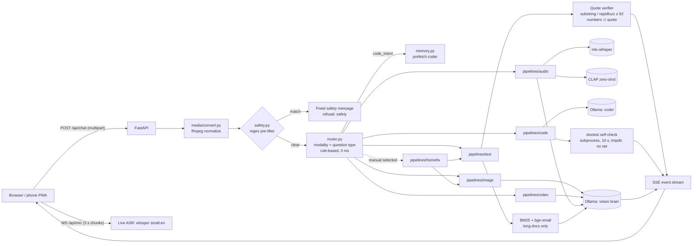

# Architecture

Everything runs on one laptop. No network calls at runtime (`HF_HUB_OFFLINE=1`, `TRANSFORMERS_OFFLINE=1`, Ollama on localhost).

## Request flow

## Memory budget
| Component | full (M4 16 GB) | lite (M2 8 GB) |
|---|---|---|
| Vision brain | qwen3-vl:8b-instruct ≈ 6.2 GB disk (~7 GB loaded w/ 16k ctx) | qwen3-vl:2b-instruct ≈ 1.9 GB (~2.5 GB loaded) |
| Coder | qwen2.5-coder:7b ≈ 4.7 GB, swapped in (brain unloaded) | qwen2.5-coder:3b ≈ 1.9 GB, swapped in (brain unloaded) |
| Whisper | large-v3-turbo 1.6 GB + small.en 0.5 GB (live mic) | small.en 0.5 GB (file and live) |
| CLAP | 0.6 GB | 0.6 GB |
| bge-small | 0.13 GB weights (0.4 GB repo) | 0.13 GB |
| **Models total** | **≈ 10 GB** with the 7b coder swapped in, not resident (target ≤ 11) | **≈ 4 GB peak** (one LLM at a time) |
| OS + browser + Python | ~4–5 GB | ~3–4 GB |

Measured peak: 7.2 GB on `full`, 3.0 GB on `lite` (eval runs, see [MODELS.md](MODELS.md)).

## Streamed vs batched
| Streamed (SSE tokens) | Batched (single event, then text streams) |
|---|---|
| Brain answer text for image, video, audio Q&A, code explanation | Whisper file transcript (`transcript` event) |
| Live mic partial transcripts (WS) | CLAP labels (`sound_labels`) |
| Status chips (`status` per stage) | Text answers (**must be verified before display**, so we stream status, then the verified answer) |
| | Code + self-check result (`code_result`) |

## Limits we name openly
- **Small models, not frontier models.** A 2–8B vision model miscounts crowded scenes (>8 objects) and misreads very blurry text. We prompt for "I can't tell" instead of guessing.
- **Video = sampled frames**, not true temporal modelling. Fast motion between frames, or events shorter than the frame spacing (~1–2 s on 16 frames / 30 s), can be missed.
- **Zero-shot sound ID** is only as good as the label vocabulary; rare or appliance-specific sounds may map to the nearest generic label.
- **Text refusals are conservative.** The verifier prefers "not in the document" over an unsupported answer, which costs some recall on answerable questions.
- **Code self-check** only runs the docstring examples, not hidden tests; passing it does not guarantee correctness.
- **Live mic** quality depends on room noise; partials are re-transcribed with the file model on stop.
- **Phone access** requires HTTPS (or localhost) for camera/mic, and a local network with the laptop.
